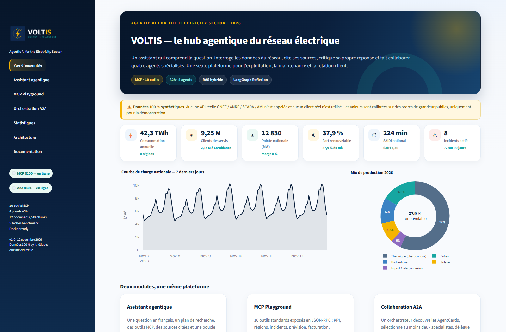
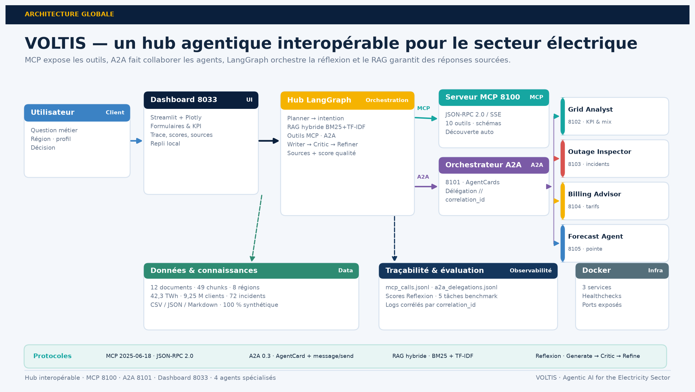
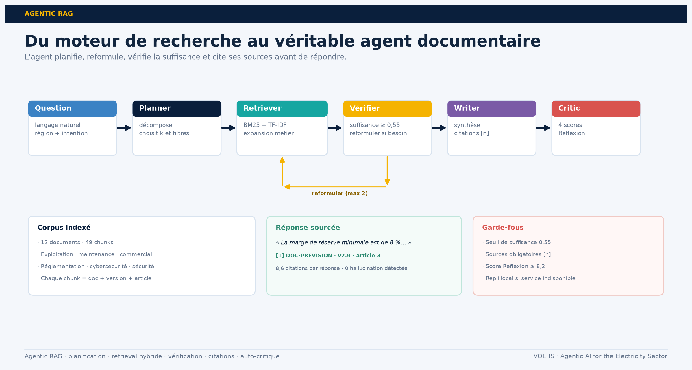
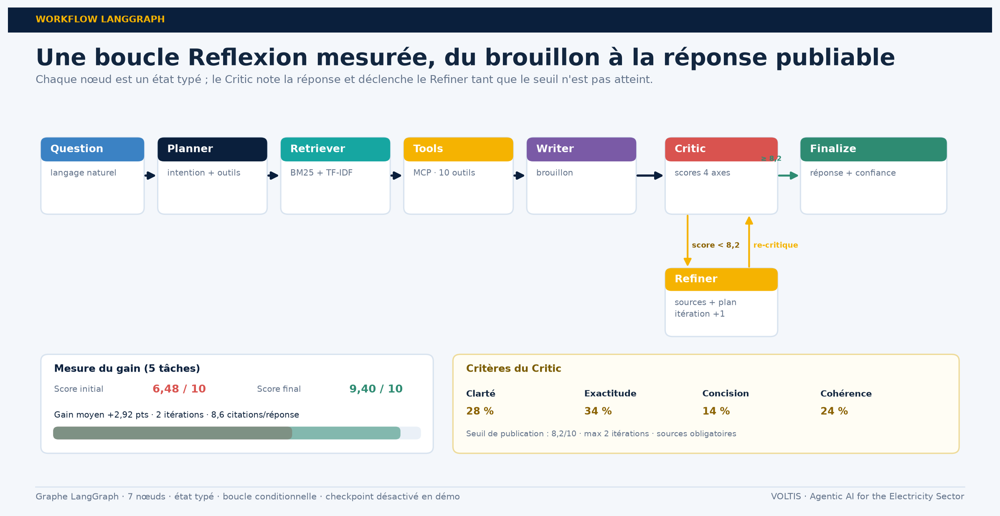

# ⚡ VOLTIS — Agentic AI for the Electricity Sector

**Un hub agentique interopérable pour le réseau électrique : MCP, A2A, RAG, LangGraph, dashboard et Docker.**


[](https://python.org)
[](http://localhost:8033)
[](http://localhost:8100)
[](http://localhost:8101)
[](https://docs.docker.com/compose)
[](https://github.com/kamalelafoui/Agentic-AI-Electricity-VOLTIS)

---

## 🎯 En 30 secondes

VOLTIS répond à des questions métier sur le réseau électrique en combinant **données structurées**, **procédures internes** et **agents spécialisés**. Chaque réponse est **chiffrée**, **sourcée**, **notée** et **traçable**.

| Question | Agent mobilisé | Réponse |
|---|---|---|
| « Pourquoi Maârif a-t-il subi une coupure ? » | Outage Inspector | Incident, cause, durée, clients, plan d'action |
| « Quel est le mix national ? » | Grid Analyst | 42,3 TWh, 37,9 % renouvelable, détail par source |
| « Simule la facture d'un industriel à 250 MWh » | Billing Advisor | 344 700 MAD, détail des tranches et TVA |
| « Risque de pointe demain à 19 h avec +5 °C ? » | Forecast Agent | 2 913 MW, marge 12,4 %, risque élevé |

```text
Score Reflexion : 6,48/10 → 9,40/10  (+2,92 pts sur 5 tâches)
```

---

## 🖥️ Aperçu du dashboard



Le dashboard est accessible sur **http://localhost:8033**. Il propose 7 pages :

1. **Vue d'ensemble** — KPI, courbe de charge, mix, régions, incidents récents.2. **Assistant agentique** — formulaire, réponse, scores, trace, sources, export JSON.
3. **MCP Playground** — catalogue des 10 outils, appel, résultat JSON, latence.
4. **Orchestration A2A** — AgentCards, timeline, artifacts, correlation_id.
5. **Statistiques** — filtres, 5 graphiques, tableau régional, benchmark.
6. **Architecture** — 6 schémas, ports, critères, manifests téléchargeables.
7. **Documentation** — DOCX, PDF, PPTX, captures et commandes.

🎬 **Vidéo de démonstration** : [`videos/VOLTIS_Demo.mp4`](videos/VOLTIS_Demo.mp4) — 1 min 50, narration française.

---

## 🏗️ Architecture



```text
Utilisateur → Dashboard 8033 → Hub LangGraph
                                  ├── MCP 8100 (10 outils)
                                  ├── A2A 8101 → 4 agents (8102-8105)
                                  └── RAG hybride (12 documents, 49 chunks)
```

| Couche | Technologie | Rôle |
|---|---|---|
| Expérience | Streamlit + Plotly | Formulaires, KPI, graphiques, traces |
| Orchestration | LangGraph | Planner → Retriever → Tools → Writer → Critic → Refiner |
| Agents | A2A 0.3 | Grid Analyst, Outage Inspector, Billing Advisor, Forecast Agent |
| Outils | MCP 2025-06-18 | 10 outils, ressources, prompts, JSON Schema |
| Connaissance | BM25 + TF-IDF | Retrieval hybride, citations, filtre métier |
| Infrastructure | Docker Compose | 3 services, healthchecks, volumes partagés |

---

## 🚀 Démarrage rapide

### Option 1 — Local

```bash
# 1. Environnement
python -m venv .venv
.venv\Scripts\activate          # Windows
# source .venv/bin/activate     # macOS / Linux

# 2. Dépendances
pip install -r requirements.txt

# 3. Tout lancer (dashboard + MCP + A2A)
python main.py
```

Ouvrir **http://localhost:8033**.

### Option 2 — Docker

```bash
docker compose up --build
```

| Service | URL | Healthcheck |
|---|---|---|
| Dashboard | http://localhost:8033 | `/_stcore/health` |
| MCP | http://localhost:8100 | `/api/health` |
| A2A | http://localhost:8101 | `/health` |

### Commandes utiles

```bash
python main.py dashboard    # dashboard seul (8033)
python main.py mcp          # serveur MCP seul (8100)
python main.py a2a          # orchestrateur + agents (8101-8105)
python main.py demo         # benchmark Reflexion + démo A2A
python main.py check        # validation des données et livrables
python main.py build        # régénère données, schémas, JSON, DOCX, PPTX
```

---

## 🔌 MCP — 10 outils standards

| Outil | Catégorie | Description |
|---|---|---|
| `get_grid_kpis` | Analytics | KPI nationaux |
| `get_region_profile` | Analytics | Profil d'une région |
| `get_consumption` | Analytics | Série mensuelle |
| `get_production_mix` | Analytics | Mix et CO₂ |
| `query_outages` | Exploitation | Incidents et filtres |
| `forecast_load` | Prévision | Pointe, marge, risque |
| `simulate_bill` | Commercial | Facture et tranches |
| `search_knowledge` | RAG | Recherche hybride |
| `recommend_energy_savings` | Commercial | Plan d'économies |
| `get_service_quality` | Qualité | SAIDI / SAIFI |

**Endpoints** : `POST /mcp` (JSON-RPC), `GET /sse`, `POST /api/tool`, `GET /api/health`.

```json
{"jsonrpc":"2.0","id":1,"method":"tools/call",
 "params":{"name":"forecast_load","arguments":{"region_code":"CAS","temperature_delta":5}}}
```

---

## 🤝 A2A — 4 agents, 1 hub

| Agent | Port | Expertise |
|---|---|---|
| Grid Analyst | 8102 | KPI, consommation, mix |
| Outage Inspector | 8103 | Incidents, SAIDI/SAIFI, MTTR |
| Billing Advisor | 8104 | Factures, tarifs, économies |
| Forecast Agent | 8105 | Prévision, pointe, réserve |

Chaque agent publie une **AgentCard** sur `/.well-known/agent.json` et accepte `POST /message`.
L'orchestrateur expose `GET /agents`, `POST /discover`, `POST /orchestrate` et génère un
**correlation_id** propagé dans `data/a2a_delegations.jsonl`.

---

## 📚 RAG agentique

- **12 documents** / **49 chunks** : délestage, maintenance, code réseau, tarifs, renouvelables,
  incidents, AMI, sécurité, relation client, cybersécurité, prévision, réglementation.
- **Retrieval hybride** : BM25 (0,66) + TF-IDF (0,86) + bonus de titre et de phrase.
- **Filtre métier** : chaque intention ne cite que les documents autorisés.
- **Citations** : `DOC-PREVISION · v2.9 · article 3`.
- **Vérification** : seuil de suffisance 0,55, reformulation max 2.



---

## 🔁 Reflexion — Generate → Critic → Refine



| Critère | Poids | Signaux |
|---|---|---|
| Clarté | 28 % | Titres, bullets, longueur, phrases |
| Exactitude | 34 % | Chiffres, citations, outils, unités |
| Concision | 14 % | Longueur, répétitions |
| Cohérence | 24 % | Synthèse, plan, sources, limites |

**Seuil de publication** : 8,2/10 · **max 2 itérations**.

---

## 📊 Benchmark

| Tâche | Initial | Final | Gain |
|---|---|---|---|
| T1 — Coupure Maârif | 6,4 | 9,1 | +2,7 |
| T2 — Mix national | 6,4 | 9,5 | +3,1 |
| T3 — Facture industrielle | 6,5 | 9,4 | +2,9 |
| T4 — Risque de pointe | 6,6 | 9,5 | +2,9 |
| T5 — Pertes réseau | 6,5 | 9,5 | +3,0 |
| **Moyenne** | **6,48** | **9,40** | **+2,92** |

Latence moyenne : **35,7 ms** · **8,6 citations/réponse**.

---

## 📦 Livrables

| Livrable | Fichier |
|---|---|
| Documentation finale | `docs/Documentation_Finale_VOLTIS.docx` / `.pdf` |
| Présentation finale | `presentation/Presentation_Finale_VOLTIS.pptx` / `.pdf` |
| Dashboard | `dashboard/app.py` |
| Serveur MCP | `mcp_server/server.py` |
| Orchestrateur A2A | `a2a/server.py` + `a2a/agents.py` |
| Workflow LangGraph | `langgraph_workflow/workflow.py` |
| Manifests JSON | `json/*.json` + `json/agent_cards/*.json` |
| Docker | `Dockerfile`, `docker-compose.yml` |

Voir `LIVRABLES.md` pour la correspondance complète avec les critères de validation.

---

## 📁 Structure

```text
Agentic_AI_Electricity_FINAL/
├── main.py                     # lanceur unique
├── dashboard/app.py            # dashboard Streamlit 8033
├── mcp_server/server.py        # serveur MCP 8100
├── a2a/                        # orchestrateur + 4 agents + 5 AgentCards
├── langgraph_workflow/         # graphe Planner → Critic → Refiner
├── shared/electricity_core.py  # socle métier, RAG, outils, simulations
├── data/                       # CSV, JSON, corpus Markdown
├── json/                       # manifests MCP, A2A, RAG, LangGraph, architecture
├── docs/                       # DOCX + PDF
├── presentation/               # PPTX + PDF
├── assets/                     # logo + schémas + graphiques
├── screenshots/                # captures du dashboard
├── videos/                     # vidéo de démonstration (1 min 50)
├── scripts/                    # build_data, build_json, build_docs, build_deck…
├── tests/                      # tests unitaires
├── Dockerfile
└── docker-compose.yml
```

---

## ✅ Critères de validation

| Critère | Preuve |
|---|---|
| Interopérabilité | MCP JSON-RPC + A2A HTTP + AgentCards |
| Agentic RAG | Planner, retrieval multi-étapes, vérification, citations |
| Collaboration ≥ 2 agents | L'orchestrateur sélectionne 2 à 4 agents |
| Auto-réflexion | Writer → Critic → Refiner, scores avant/après |
| Architecture | Hub, 6 couches, ports, flux, ADR |
| Documentation | DOCX 23 pages, README, 5 AgentCards |
| Démonstration | Dashboard 8033 + scénario bout en bout + captures |

---

## 🔒 Sécurité et limites

- Données **100 % synthétiques**, aucun client réel.
- Validation JSON Schema des appels MCP.
- Repli local si MCP/A2A sont indisponibles.
- En production : jeton Bearer, mTLS, RBAC, rate limiting.
- Limites : pas de SCADA réel, prévision par persistance, pas d'embeddings, pas d'authentification.

---

## 📄 Licence

MIT — voir `LICENSE`.

**Dépôt GitHub :** https://github.com/kamalelafoui/Agentic-AI-Electricity-VOLTIS

**VOLTIS v1.0.0** · 12 novembre 2026 · Direction Digitale & Exploitation
